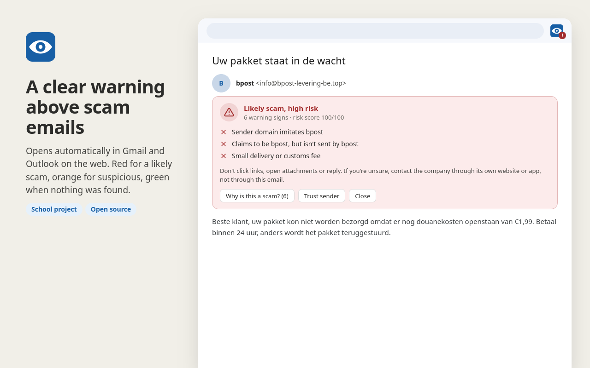

<p align="center"></p>

<h1 align="center">Scam Detector</h1>

<p align="center">
  A Firefox extension that warns you about phishing and scam emails in <b>Gmail</b> and <b>Outlook on the web</b>,<br>
  and explains why in plain language. Everything is checked on your own device.
</p>

<p align="center">
  <a href="https://addons.mozilla.org/firefox/addon/scam-detector-school/">Firefox Add-ons</a> ·
  <a href="https://twixaddict.github.io/scam-detector/">Website &amp; live demo</a> ·
  <a href="https://twixaddict.github.io/scam-detector/privacy.html">Privacy policy</a>
</p>

> **A school project, open source.** Scam Detector was made as a school project. All of its code is in this repository under the [MIT License](LICENSE), so anyone can read what it does, check it, or improve it. It is not made by, or connected to, Google, Microsoft or any brand it mentions. No checker catches every scam: a green card means "nothing obvious found", not a guarantee.



## What it does

When you open an email in Gmail or Outlook on the web, a card appears above it:

- **Red, "Likely scam, high risk"** (score 60+): don't click, don't reply.
- **Orange, "Suspicious, be careful"** (score 30+): check before you act.
- **Green, "Low risk" or "No warning signs"**.

Each card lists the reasons ("Claims to be bpost, but isn't sent by bpost", "A link shows one address but goes to another"). **Why is this a scam?** opens the full explanation, **Trust sender** stops flagging a sender's wording, and **Close** hides the card.

Also included:

- **Toolbar button:** shows `!` or `?` for the open email; **Scan this page** checks any other page or webmail; **Check email source…** opens the source checker.
- **Email source checker:** paste an email's full source or drop an `.eml` file. This is the only way to check SPF, DKIM, DMARC and Reply-To, which webmail hides. Gmail's own "Show original" page is checked automatically. Comes with 10 example emails.
- **Settings:** language (automatic, English, Nederlands, Français), sensitivity, trusted senders, your organization's domains, the phishing list and sender memory.
- Cards follow your **mailbox's** light or dark theme.

## Privacy

- Emails are analyzed inside your browser and **never sent anywhere**. No analytics, no tracking, no account.
- The only download is the public [OpenPhish](https://openphish.com/) list of phishing links, every 6 hours. Your links are compared with it on your own computer. It can be turned off.
- "Remember who emails me" keeps sender addresses and names in the extension's local storage, to spot impostors who copy a known name. It can be turned off and cleared.
- The manifest declares `data_collection_permissions: none`. Full details: [privacy policy](docs/privacy.html).

## Install

**From Firefox Add-ons:** [addons.mozilla.org/firefox/addon/scam-detector-school](https://addons.mozilla.org/firefox/addon/scam-detector-school/) (Firefox 140 or newer, including Firefox-based browsers like Zen).

**From this repository (for testing):**

1. Download or clone this repository.
2. In Firefox, go to `about:debugging#/runtime/this-firefox`.
3. Click **Load Temporary Add-on…** and choose `extension/manifest.json`.
4. Open Gmail or Outlook on the web and open an email.

Temporary add-ons are removed when Firefox restarts.

If no card appears, open the extension's popup while Gmail is open. Its top line says whether automatic warnings are running, with a one-click fix if they aren't: **Allow automatic warnings** when the browser didn't give the extension access to Gmail, or **Start them now** when the tab was open before the extension loaded.

## How it works

Each warning sign has a weight; the weights add up to a risk score from 0 to 100. Strong signs (★ in the table below) are enough for a warning on their own, weak ones only count together. The signs come from the research notes in [scam-email-detection-signals.md](scam-email-detection-signals.md).

```
extension/                 The add-on itself (exactly what is uploaded to Firefox Add-ons)
  manifest.json            Firefox Manifest V3
  icons/                   Eye icon (SVG and PNG)
  src/core/                Pure logic, no browser APIs
    lists.js               Brands and their real domains, known companies, free-mail providers, risky TLDs, file types
    i18n.js                All text in English, Dutch and French
    domain.js              Registrable domains, punycode, lookalike characters, lookalike domains, link unwrapping
    phrases.js             Scam wording in English, Dutch, French and German
    detector.js            Every check and the scoring: analyze(email) -> { score, level, findings }
    html.js                Email body -> visible text, hidden text, links, images, form fields
    mime.js                Raw .eml parser (headers, encodings, multipart, attachments)
  src/content/             Runs inside Gmail and Outlook
    adapters.js            Finds the open email in the Gmail and Outlook page
    runner.js              Settings, sender memory, phishing-list lookup
    content.js             Watches the page and inserts the card (in a shadow root)
  src/background/          Downloads the OpenPhish list, answers link lookups, sets the badge
  src/ui/                  The result card and shared page styles
  src/popup/ src/options/ src/analyzer/
docs/                      Website (GitHub Pages): landing page, live demo, privacy policy
store/                     Firefox Add-ons listing text, screenshots and icon
scripts/                   check.py, build.sh, build-site.sh, make_icons.py, make_screenshots.sh
test/                      Browser test suite (tests.html) and a preview of every card state (preview.html)
```

### Signal coverage

| Area | Checked | Not checked (why) |
|---|---|---|
| Sender | ★ brand name on someone else's address, ★ lookalike domains (misspellings, digit swaps, Cyrillic/Greek letters, punycode, "brand-secure"), ★ failed SPF/DKIM/DMARC (source checker and Gmail "Show original"), Reply-To elsewhere, organizations on free mail, an address hidden in the name, a known name from a new address, outsiders imitating your organization, famous names (donation scams), odd-looking addresses (random characters, a name that's nowhere in the address, a country domain writing in another language, Gmail's "via") | Domain age (needs a server), `Received` chain |
| Links | ★ link text vs. real destination, ★ OpenPhish list (checked locally), brand in a subdomain or path, IP addresses, shorteners, redirects, risky TLDs, encoded URLs, the `@` trick, free hosting and form builders, "sign in to view the shared document", plain-HTTP login links, one odd login button, `javascript:` links, fake attachment links, WhatsApp/Telegram links. Gmail, Outlook Safe Links and Proofpoint wrappers are unwrapped first; a known company's own trackers are allowed. | Expanding short links (needs a server), decoding QR images |
| Attachments | ★ programs (.exe, .js, .iso…), ★ HTML/SVG files (stronger with a form or script), double extensions, macro files, archives with the password in the mail, misleading names, right-to-left tricks | Looking inside archives |
| Wording | ★ urgency, ★ password/card requests, ★ gift cards, crypto and bank-detail changes, generic greetings, too good to be true, large money promises (advance fee), secrecy, fake "scanned, safe" banners, parcel and customs fees, tax lures, blackmail, fake invoices with a phone number, fake "Re:", reply bait, online casino and pirate-TV (IPTV) adverts, pushy sales wording | Spelling and grammar (weak now that scammers use AI) |
| HTML tricks | ★ hidden text (only text you can't see anywhere else; newsletter preview lines and mobile copies are ignored), invisible characters inside words, image-only mails, brand logos hosted elsewhere, forms and password fields, scripts | Tracking pixels (too common in normal mail) |
| Context | Payroll and payment-change requests, urgent mail at night or on weekends, hidden or very long recipient lists | Reply-chain hijacking (needs much more mail history) |

Mail from the real domain of a **known company** (the brand list plus services like GitHub, Smartschool, NMBS, Vinted and FlixBus in `src/core/lists.js`) is treated like a trusted sender: its wording isn't flagged, but its links and attachments are still checked. Impostors on free mail or lookalike domains are not trusted.

## Development

Requirements: Firefox 140+, Python 3. There is no build step and no dependencies; the code runs as written.

```bash
# Run the tests: open http://127.0.0.1:8765/test/tests.html (the title shows PASS when all pass)
python3 -m http.server 8765

# Check the extension and build the zip for Firefox Add-ons (dist/scam-detector-<version>.zip)
scripts/build.sh

# Build the website locally and open http://127.0.0.1:8000
scripts/build-site.sh && python3 -m http.server -d _site 8000

# Redraw the icons or the store screenshots
python3 scripts/make_icons.py
scripts/make_screenshots.sh
```

To change any text, edit `extension/src/core/i18n.js` (English, Dutch and French side by side). The test suite fails if a text is missing in one of the languages.

Releasing is described in [PUBLISHING.md](PUBLISHING.md).

## Contributing

Found an email that was missed, or a normal email that got a warning? [Open an issue](https://github.com/TwixAddict/scam-detector/issues) and include the sender line and the card's reasons, but **remove any personal information** first. Pull requests are welcome; please run the tests and `scripts/check.py` before sending one.

## License

[MIT](LICENSE). Made as a school project.
